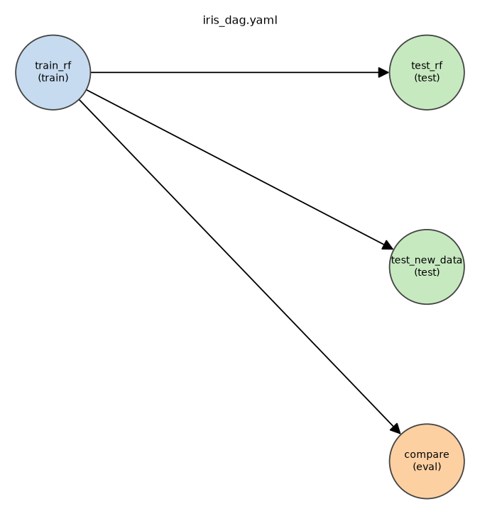

# intelligence-sdk

Config-driven model building. One YAML **recipe** describes datasets, a preprocessing
pipeline, a model and what to do with it (train / test / eval); the SDK validates the
whole recipe up front, runs it, and leaves a reproducible provenance bundle per run.

Scope is deliberately small (numeric tabular data, scikit-learn); the design is where the effort went.

## Quickstart

```bash
uv pip install -e ".[dev]"                 # or: pip install -e ".[dev]"
python tools/make_iris_csv.py              # sample data is not committed; this writes data/iris.csv

python tools/intelligence_cli.py inspect --recipe configs/iris_dag.yaml   # validate + DAG, no run
python tools/intelligence_cli.py run     --recipe configs/train_iris.yaml  # train with grid search
python tools/intelligence_cli.py run     --recipe configs/test_iris.yaml   # score the recorded holdout
python tools/intelligence_cli.py run     --recipe configs/eval_iris.yaml   # k-fold model comparison
python tools/intelligence_cli.py run     --recipe configs/iris_dag.yaml   # 4-section DAG, end to end
python tools/intelligence_cli.py list-components --model random_forest     # what a recipe may name
pytest
```

From Python the whole public surface is three names:

```python
from intelligence_sdk import load_recipe, run_recipe, default_runner

outputs = run_recipe("configs/iris_dag.yaml")          # {section_name: SectionOutput}
outputs["train_rf"].run_dir, outputs["test_rf"].metrics
```

## A recipe

```yaml
datasets:                          # registry of named datasets (reserved key)
  iris_1:
    source: file                   # file | library (scikit-learn bundled: iris, wine, breast_cancer)
    path: data/iris.csv
    target: species
    # filter:                      # optional row filter by id: include first, then exclude
    #   exclude: data/outliers.csv #   a one-column csv of ids, or an inline list

train_rf:                          # any identifier -> artifacts/train_rf/<run_id>/
  type: train
  datasets:
    - dataset_name: iris_1         # registry reference, or an inline `dataset:` definition
  split:                           # recorded once as row ids; never recomputed downstream
    test_size: 0.2
    stratify: true
  seed: 42
  pipeline:
    - step: standard_scaler        # standard_scaler | min_max_scaler | simple_imputer
  model:
    name: random_forest
    params:
      n_estimators: [20, 50]       # a list means "search these"; scalars are fixed
      max_depth: 3
  search:
    cv: 3
    scoring: accuracy

test_rf:
  type: test
  depends_on: [train_rf]           # explicit dependency = model source (dataset inherited too)
  rows: holdout                    # holdout (recorded ids, hash-checked) | all

compare:
  type: eval
  depends_on: [train_rf]           # ordering only for eval
  datasets:
    - dataset_name: iris_1
  folds: 5
  candidates:
    - name: random_forest
    - name: logistic_regression
  metrics: [accuracy, f1_macro]
```

### Section types

| type  | what it does | leaves behind |
|-------|--------------|---------------|
| `train` | split by row id, optional grid search (own loop, k-fold per candidate), refit best, score holdout | `model.joblib`, `model.json`, `dataset.json` (hash + train/holdout ids), `metrics.json`, `search_results.csv`, `candidates/`, `resolved_recipe.yaml`, `run.json` |
| `test`  | load a trained model, score rows, metrics if the target column is present | `predictions.csv`, `metrics.json`, `dataset.json` (what was scored, hash match) |
| `eval`  | stratified k-fold comparison of candidate models | `eval_report.csv` (candidate × fold), `eval_summary.csv` (mean/std, ranked), `folds.json` |

`eval` is model selection and never touches a recorded holdout; `test` is the one honest
number on rows that were never used to fit or choose.

### Sections form a DAG

`depends_on` makes explicit edges. A section without `depends_on` is chained after the
previously listed one (YAML order is load-bearing). **Implicit edges order, explicit
edges mean**: only explicit edges carry model/dataset inheritance, so a standalone test
with a `model_path` can sit after a train section without inheriting from it.
`inspect` validates the DAG, components and metric compatibility and draws it:



### Where a test gets its model and data

| recipe | model | data | rows default | hash mismatch |
|--------|-------|------|--------------|---------------|
| `depends_on: [train_x]`, no `datasets` | from `train_x` | inherited from the model's `dataset.json` | `holdout` | **refused** (`--allow-dataset-mismatch` overrides) |
| `model_path: artifacts/train_x/latest`, no `datasets` | from path | inherited | `holdout` | refused |
| either model source + explicit `datasets` | as above | the given dataset | `all` | recorded, never refused (inference on new data) |

Dataset identity is a content hash (MD5 of the file, or of the canonical frame for
library datasets). In a production system this hash lives behind DVC; a test against a
different hash is reported as leakage, because the recorded holdout ids no longer
identify the same rows.

**Stated v1 decision:** an explicit dependency on a test section names its model source.
"A test with `model_path` that merely wants to run after an eval" is not expressible in
v1; listing order still gives it an implicit ordering edge. `rows: {ids: [...]}` is a
documented seam, not built.

### Errors teach

Every problem is reported with its config path and, where possible, a suggestion, and
the whole recipe is checked before any data is read:

```
train_rf.model.params.n_estimator: not a hyperparameter of random_forest; valid: ... (did you mean 'n_estimators'?)
compare.metrics[0]: f1_macro is a classifier metric; candidates[0] linear_regression is a regressor
t.pipeline: feature column(s) with missing values: sepal_length; add a 'simple_imputer' step or filter those rows
recipe is not a DAG; dependency cycle: a -> b -> a
```

Covered in code: unknown/typoed fields, unknown components, bad hyperparameter names,
missing data files, missing/typoed target column, NaNs (with and without an imputer),
non-numeric features, tiny classes under stratification, empty filters, dataset-hash
mismatch, invalid section names, cycles. Out of scope: schema drift, class imbalance,
data versioning beyond the hash, leakage outside the pipeline.

## Architecture

Hexagonal, with ports only where variation actually exists.

```
intelligence_sdk/
  __init__.py        facade: load_recipe, run_recipe, default_runner
  interfaces/        ports: DataLoader, ModelBackend, ArtifactStore, Evaluator
  core/              domain: recipe schema, registry enums, DAG, splits, filters, runner
  adapters/          loaders/csv.py, loaders/library.py, sklearn_backend.py,
                     local_artifacts.py, evaluator.py, dag_render.py
  factory/           composition root: default_runner()
tools/intelligence_cli.py   a consumer of the facade; not distributed
```

One-way import rule: `tools/cli → facade → factory → {core, adapters} → interfaces → core/types`.

- `core` never imports `adapters`. `interfaces` imports only `core/types`.
- `factory` is the only module that names an adapter (`grep -rn SklearnBackend intelligence_sdk` → one import).
  `adapters/__init__.py` is empty on purpose so no convenience re-export breaks that claim.
- Components are **registry enums the SDK owns** (`core/registry.py`); the sklearn adapter
  maps them to classes. Config can never name an import path.
- The backend contracts to return predictions plus a `ResultType` (class_label /
  class_probability / continuous), so one array-based evaluator serves every backend
  and config needs no task-type field.
- Splits are numpy-only domain logic on **row ids**, so what `dataset.json` records can be
  re-selected exactly on a reloaded, filtered frame.

**Extending it.** A torch backend is one file in `adapters/` implementing `ModelBackend`
plus one line in `factory/`. An S3 artifact store is the same shape. A `preprocess`
section type is a new member of the discriminated union in `core/recipe.py` and a
handler in the runner. `default_runner()` is the batteries-included assembly;
`Runner(...)` is the override point for custom wiring.

## Repo layout

```
configs/    train_iris.yaml  test_iris.yaml  eval_iris.yaml  iris_dag.yaml
data/       sample csv files, git-ignored; `tools/make_iris_csv.py` regenerates iris.csv
tests/      recipe validation, DAG semantics, splits, golden iris runs, edge cases, CLI
artifacts/  created by runs: <section>/<run_id>/ with a `latest` pointer per section
```
