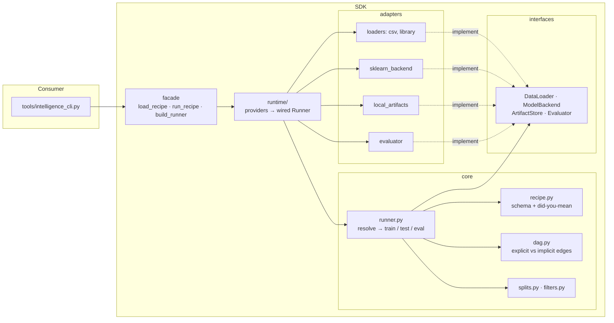

# Architecture

## Two phases, one DAG

A recipe is validated completely before any data is read, then executed section by
section in topological order. Each section leaves a provenance bundle and hands a
`SectionOutput` to its dependants.



Imports flow one way: `tools → facade → runtime → {core, adapters} → interfaces → core/types`.
`interfaces` are abstract base classes every adapter inherits; `core` codes against
them and never imports an adapter; `runtime/providers.py` is the only module that
names both sides, and `runtime.backend` / `runtime.artifact_store` pick implementations
from its tables by enum.

## The recipe model

| key | meaning |
|-----|---------|
| `runtime` | optional; which backend and artifact store run the recipe (recipe-wide, since a test must load a model with the backend that saved it) |
| `datasets` | registry of named dataset definitions: `source: file` (csv, MD5 of bytes) or `source: library` (scikit-learn bundled, hash of the canonical frame); optional id filter |
| any other key | a section; its `type` (`train`, `test`, `eval`) selects the schema |

Sections form a DAG. `depends_on` makes **explicit** edges. A section without
`depends_on` is chained after the previously listed one with an **implicit** edge, so
YAML order matters. Implicit edges only order execution; only explicit
edges carry model and dataset inheritance, which is what lets a standalone test with a
`model_path` sit after a train section without inheriting from it.

| section | does | leaves behind |
|---------|------|---------------|
| `train` | split by row id, grid search when a param is a list (own loop, k-fold per candidate), refit the best, score the holdout | `model.joblib`, `model.json`, `dataset.json` (hash, train/holdout ids), `metrics.json`, `search_results.csv`, `candidates/`, `resolved_recipe.yaml`, `run.json` |
| `test` | load a trained model, score rows, metrics if the target column is present | `predictions.csv`, `metrics.json`, `dataset.json` (what was scored, hash match) |
| `eval` | stratified k-fold comparison of candidates | `eval_report.csv` (candidate × fold), `eval_summary.csv` (ranked), `folds.json` |

Eval is model selection and never touches a recorded holdout; test is the one honest
number on rows that were never used to fit or choose.

Where a test gets its model and data:

| recipe says | model | data | rows | hash mismatch |
|-------------|-------|------|------|---------------|
| `depends_on: [train_x]`, no `datasets` | `train_x` | inherited from the model's `dataset.json` | `holdout` | refused (`--allow-dataset-mismatch` overrides) |
| `model_path: …/latest`, no `datasets` | path | inherited | `holdout` | refused |
| either, plus explicit `datasets` | as above | the given dataset | `all` | recorded, never refused |

The dataset hash is the leakage guard: a different hash means the recorded holdout ids
no longer identify the same rows. In production that hash would be owned by DVC.

## Design choices in one line each

- Component names are enums the SDK owns; config can never name an import path.
- The backend returns predictions plus a `ResultType`, so one array-based evaluator
  serves every backend and config needs no task-type field.
- Splits are numpy-only domain logic on row ids, so a filtered, reloaded frame
  re-selects exactly the recorded rows.
- Every validation error names the config path and suggests a fix; the whole recipe is
  checked, including hyperparameter names and metric/model compatibility, before any IO.

## Target state

This SDK is the piece I would ship first of a larger toolkit. In production I would
split the layers into independently versioned repos under one root with a Makefile
and submodules:

```
intelligence-toolkit/              # root: Makefile, README, submodules
├── intelligence-services/         # FastAPI service layer: routes, connectors; hexagonal
├── intelligence-sdk/              # this repo: frameworks unified behind train / preprocess / predict
├── intelligence-datasets/         # dataset access + versioning (the DVC-owned hashes live here)
├── intelligence-inference-engine/ # C++ inference core over ONNX Runtime / OpenVINO / TensorRT, pybind11 to the SDK
└── intelligence-iac/              # Terraform to deploy the stack onto Kubernetes
```

The seams already exist here: `ModelBackend` is where a torch backend or the C++
engine's Python wrapper plugs in, `DataLoader` is where `intelligence-datasets`
replaces the local csv/library loaders, and `ArtifactStore` is where an object store
replaces the local directory. The services layer would import the same three facade
names the CLI does.
