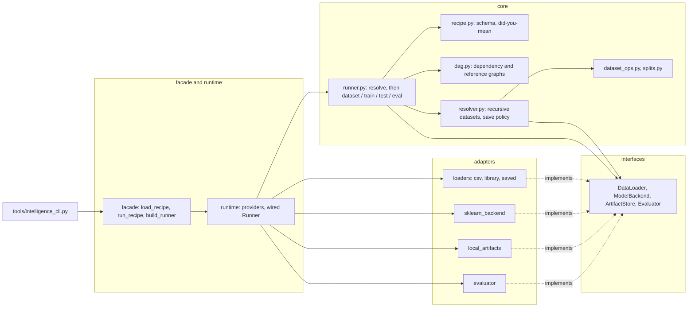

# Architecture

A recipe is validated completely before any data is read, then executed node by
node. Every node consolidates the datasets it names into one dataset, applies its own
dataset operations to it, acts, and writes a run card when it has a `recipe_output`.

## Overview



Imports flow one way: `tools → facade → runtime → {core, adapters} → interfaces → core/types`.
`interfaces` are abstract base classes every adapter inherits; `core` codes against
them and never imports an adapter; `runtime/providers.py` is the only module that
names both sides, and `runtime.backend` / `runtime.artifact_store` pick implementations
from its tables by enum.

- Component names are enums the SDK owns; config can never name an import path.
- The backend returns predictions plus a `ResultType`, so one array-based evaluator
  serves every backend and config needs no task-type field.
- Data operations (filter, split, folds, save) belong to datasets and are recorded by
  row id, so a saved dataset can be reloaded and filtered by its own split.
- Every validation error names the config path and suggests a fix; both graphs,
  references, hyperparameter names, metric/model compatibility and paths are checked
  before IO.

## Recipe

| key | meaning |
|-----|---------|
| `runtime` | optional; which backend and artifact store run the recipe |
| `datasets` | registry of named dataset specs: `source: file`, `library` or `dataset` (one saved by this tool), each with optional `filter`, `split`, `folds`, `seed`, `save_dataset` |
| any other key | a node; its `type` (`dataset`, `train`, `test`, `eval`) selects the schema |

Every node has a `datasets` list whose entries are references (`dataset_name`, to a
registry entry or a dataset node) or inline specs (`name` plus the spec fields).
Resolution is recursive and memoised per run. The entries are concatenated (row ids
must be unique unless `ignore_duplicates`), then the node's root-level `filter`,
`split`, `folds` apply to the result. A single entry keeps its own split and folds.

| node | does | run card |
|------|------|----------|
| `dataset` | consolidate and save; runs when referenced or named with `--node` | `dataset.csv`, `metadata.json`, `train_ids.csv`, `test_ids.csv` |
| `train` | fit on the train split (all rows without one); list-valued params are searched with k-fold CV over those rows; refit the best | `model.joblib`, `model.json`, `metrics.json`, `search_results.csv`, `candidates/` |
| `test` | score every offered row with a model from an explicit `depends_on` or `model_path`; metrics if the target column is present | `predictions.csv`, `metrics.json`, `model.json` |
| `eval` | compare candidates fold by fold using the folds recorded on the dataset | `eval_report.csv`, `eval_summary.csv`, `metrics.json` |

Every run card also holds `resolved_recipe.yaml`, `dataset_metadata.json` and
`run.json`. Nothing is written without a `recipe_output`.

Two graphs decide the order. `depends_on` (train, test, eval only) forms the
dependency graph; connected nodes run in topological order, nodes without edges are
isolated and run afterwards in listing order. `dataset_name` references form the
reference graph over dataset nodes; both must be acyclic. `--node X` runs X's
transitive dependencies and then X; a dataset node as target is resolved and saved.

Saving is explicit everywhere. A path that already holds a dataset is rebuilt with
`overwrite: true`, loaded with `reuse: true`, and an error otherwise; a train, test or
eval output path needs `overwrite: true` to be replaced. There is no versioning: to
score only the rows a model never saw, save the dataset and filter the test's copy
with `exclude: {split: train}`.

## Toolkit

This SDK is one layer of a toolkit split into independently versioned repos under a
root with a Makefile and submodules:

```
intelligence-toolkit/              # root: Makefile, README, submodules
├── intelligence-services/         # FastAPI service layer: routes, connectors; hexagonal
├── intelligence-sdk/              # this repo: frameworks unified behind train / preprocess / predict
├── intelligence-datasets/         # dataset access + versioning (a DVC-backed loader lives here)
├── intelligence-inference-engine/ # C++ inference core over ONNX Runtime / OpenVINO / TensorRT, pybind11 to the SDK
└── intelligence-iac/              # Terraform to deploy the stack onto Kubernetes
```

The extension points are the ports: `ModelBackend` is where a torch backend or the
inference engine's Python wrapper plugs in, `DataLoader` is where `intelligence-datasets`
replaces the local loaders, and `ArtifactStore` is where an object store replaces
the local directory. The services layer imports the same three facade names the
CLI does.
